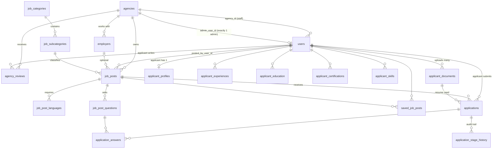

# OPAP Job Abroad — Database (source of truth)

> **This file is the origin for every table, relationship and business rule in the database.**
> If code, a migration or the mock data in `resources/js/data/*` disagrees with this file, this file wins — or this file is changed first, in the same pull request as the migration.

- **Engine:** PostgreSQL (`DB_CONNECTION=pgsql`, database `opapjobs`).
- **Framework:** Laravel + `spatie/laravel-permission` + Inertia/React.
- **Status:** design target. Today only `users`, the Spatie tables and Laravel infrastructure tables exist; everything else is still mocked in `resources/js/data/*` and `resources/js/types/*`.
- **Normalisation target:** third normal form (3NF). The only deliberate exceptions are listed in [§4](#4-normalisation-and-deliberate-exceptions).

---

## 0. Hard constraints (do not break)

1. **Spatie is untouched.** Do not modify `config/permission.php`, the published migration `2026_10_11_060858_create_permission_tables.php`, the Spatie tables/columns/pivot keys, the guard (`web`), the `HasRoles` trait usage, or the team/cache settings. Nothing in this design adds a column or foreign key to a Spatie table; every new table references **`users.id`** only. Roles stay exactly `applicant`, `agency`, `admin`, `superadmin`.
2. **No deletion, only archiving.** Archiving is Laravel **soft delete** using the standard **`deleted_at`** column. The one exception is **`job_posts`**, which archives through its stored `status` column instead (no `deleted_at`, see §8.2). See [§5](#5-archiving-rules).
3. **No draft state in the database.** Drafts live in the browser's local storage. A job post row exists only once it is posted.
4. **Vacancies are `job_posts`, never `jobs`.** Laravel's queue owns the `jobs` table. The word "listing" is not used anywhere (code, UI copy, docs): it is always **job post**.

---

## 1. Glossary (the words overlap — read this first)

| Term | Meaning |
|---|---|
| **Agency** (table `agencies`) | A recruitment agency *organisation*, licensed by DMW, with a public profile and reviews from applicants. It recruits for exactly **one pathway**. |
| **`agency` role** | A *person* working for an Agency who is not its admin ("agency user"). Value `agency`, `Role::Agency`. |
| **`admin` role** | The **single** administrator of one Agency. Agency-scoped, not platform-wide. |
| **`superadmin` role** | Platform owner. Creates Agencies and accounts, maintains the lookup data, bypasses everything. |
| **`applicant` role** | A job seeker. |
| **Employer** (table `employers`) | The *foreign hiring company* behind a vacancy. Not a user, not a role. |
| **Job post** (table `job_posts`) | One published vacancy of an Agency. |
| **Pathway** | `landbased` or `seabased`. A property of the **Agency**. |
| **Recruitment type** | `joborder` (employer is named) or `manpooling` (employer hidden from applicants). |
| **Stored status** | `job_posts.status`: `pending`, `closed`, `archived`. The manual decision. |
| **Display status** | `active`, `expired`, `closed`, `archived`. Calculated from stored status + `closing_date`, never stored (§8.2). |

---

## 2. Roles and business rules

### 2.1 Who creates whom

```
superadmin ──creates──▶ Agency
superadmin ──creates──▶ admin account         (exactly 1 per Agency)
superadmin ──creates──▶ agency-user accounts
admin      ──creates──▶ agency-user accounts  (only up to the limit the superadmin set)
applicant  ──self-registers
```

### 2.2 Rules

1. An Agency has **exactly one `admin`** and **many `agency` users**; every staff user belongs to exactly one Agency.
2. Only the **superadmin creates an Agency and its admin account**. The superadmin sets `agencies.agency_user_limit`, the number of agency-user accounts the Agency may have. The admin account does **not** count toward the limit. The superadmin may also create agency users directly.
3. **An Agency is either `landbased` or `seabased`, never both.** The pathway is set by the superadmin when the Agency is created. Every job post the Agency's staff post belongs to that pathway: the chosen subcategory must belong to a category of the Agency's pathway.
4. **Every job post is linked to** (a) the **Agency**, (b) the **staff user who posted it**, and (c) optionally an **employer**.
5. **Agency user** sees **only the job posts they posted, and the applications received on those job posts**.
6. **Admin** sees **all job posts and all applications of their Agency**, whoever posted them, and can post job posts themselves.
7. **Superadmin** sees and manages everything. The superadmin also maintains the two lookup tables in [§6](#6-lookup-tables-superadmin-maintenance): job categories and job subcategories. Nothing else is maintained in the app.
8. **Applicants** can review Agencies (**only after applying to one of that Agency's job posts**), apply to jobs, keep a profile, upload **many** documents (resumes), save jobs, and see the status of their applications.
9. An Agency has its own **public profile** and receives **reviews from many applicants** (one per applicant per Agency, editable).
10. **Only the admin and the superadmin can edit an Agency's profile.** Agency users cannot.
11. The admin may suspend and reactivate their own Agency's agency users.
12. Authorization is **permission-based** (Spatie permissions + policies). App code never checks role names directly. Data scoping (own Agency / own job posts) is applied on top of permissions.

### 2.3 Dashboard overviews

| Overview | Who uses it | Permission (existing name) |
|---|---|---|
| **System overview** | superadmin | `view system overview` |
| **Platform overview** | admin | `view platform overview` |
| **Hiring overview** | agency users only | `view hiring overview` |

The **admin has no access (not even view) to the hiring overview.** The superadmin passes every gate through `Gate::before`, so no UI is built for the superadmin on the platform or hiring overviews.

### 2.4 Capability matrix

| Capability | superadmin | admin | agency | applicant |
|---|:-:|:-:|:-:|:-:|
| Create / edit / suspend Agencies, set pathway and `agency_user_limit` | ✅ | — | — | — |
| Create admin account | ✅ | — | — | — |
| Create agency-user accounts | ✅ | ✅ within limit | — | — |
| Suspend / reactivate agency users | ✅ | ✅ own Agency | — | — |
| Edit Agency public profile | ✅ any | ✅ own | ❌ | — |
| Maintain categories and subcategories | ✅ | — | — | — |
| Post / edit / close / reopen / archive / restore a job post | ✅ any | ✅ any of own Agency | ✅ own job posts only | — |
| See job posts | all | all of own Agency | only ones they posted | display status `active` only |
| See applications | all | all of own Agency | only on job posts they posted | own only (status read-only) |
| Manage employers (hiring companies) | ✅ | ✅ own Agency | ✅ own Agency | — |
| Candidate directory | ✅ | ✅ | ✅ | — |
| Dashboard overview | system | platform | hiring | — |
| Browse jobs / Agencies | ✅ | ✅ | ✅ | ✅ |
| Apply, save jobs, manage own profile & documents | — | — | — | ✅ |
| Review an Agency | — | — | — | ✅ after applying |

---

## 3. Entity-relationship overview



A job post's **category** (and the **pathway** check) are derived through `job_subcategory_id → job_subcategories → job_categories`; they are not stored on the job post. The **Agency** and the **posting user** are stored directly (§8.2).

---

## 4. Normalisation and deliberate exceptions

The schema is in **3NF**: no column depends on anything other than its table's key, and nothing derivable is stored. Concretely:

- Derived values are **not** stored: a job post's `active` / `expired` display state (§8.2), an Agency's average rating / review count / number of job posts / "top hirer", years in operation, a job post's category and pathway, display strings such as "SAR 2,500–3,200 / mo".
- Enums are stored as single string values (atomic), not lists. Multi-valued facts use child rows (`job_post_languages`, `application_answers`), not arrays or JSON.
- Social links are separate columns, not JSON.

**Deliberate exceptions** (documented so nobody "fixes" them):

1. **Rich text column** — `job_posts.job_description` holds text with lightweight markup (bold, italic, underline, bullets, numbered lists, headings, links) from the rich-text editor. It is one atomic formatted string; only the formatting is kept, never HTML. Requirements, qualifications, benefits and any other free text the agency wants to publish go in this single column (no separate benefits or "other requirements / additional qualifications" columns). This is the 2NF-level exception chosen on purpose.
2. **`applications.stage`** holds the *current* stage although it equals the latest row of `application_stage_history`. Kept for fast filtering/board views; the history table is the audit trail. The Action that changes a stage updates both in one transaction.
3. **`job_posts.agency_id`** is stored even though the poster also belongs to an Agency (`users.agency_id`): the job post belongs to the **Agency organisation** as a first-class relationship (it must survive the poster being archived). The posting Action must verify `posted_by_user_id`'s `agency_id` equals the job post's `agency_id`, and a test must cover it.

---

## 5. Archiving rules

- Archive = set `deleted_at` (Laravel `SoftDeletes`). **Rows are never hard-deleted** if another row can reference them or they carry history.
- Tables with `deleted_at`: `users`, `agencies`, `employers`, `job_categories`, `job_subcategories`, `job_post_questions`, `agency_reviews`, `applicant_documents`.
- Archived lookup rows disappear from pickers but still resolve for rows that already use them (query with `withTrashed()` when rendering history).
- **`job_posts` do not use `deleted_at`.** They are archived by setting `status = 'archived'` (a single source of truth, no duplicated flag) and are never hard-deleted. Default job-post queries exclude archived rows through an explicit scope; archived job posts accept no applications, and the admin and the poster still see them and their applications.
- **Archived users** (including applicants who "delete" their account) keep their data and cannot sign in. Email stays unique — restore instead of re-registering.
- **Archived `agency_reviews`** (moderation or the applicant removing their review) free the one-review-per-Agency slot (partial unique index, §7.4).
- **Hard delete is allowed only for pure child/pivot rows with no history value:** `job_post_languages` (replaced on edit), `saved_job_posts` (unsave), and the applicant resume-section rows (`applicant_experiences`, `applicant_education`, `applicant_certifications`, `applicant_skills`) that nothing else references.
- `application_stage_history`, `applications` and `application_answers` are never deleted by agencies; an applicant hides an application from their own view with `applicant_archived_at`.

---

## 6. Lookup tables (superadmin maintenance)

Only **two** tables are maintained in the app. Each has its own superadmin screen with create, rename, reorder and archive.

| Table | Columns | Constraints |
|---|---|---|
| **`job_categories`** | `id`, `pathway` (`landbased`\|`seabased`), `category_name`, `sort_order`, `deleted_at`, timestamps | `UNIQUE (pathway, category_name)` among non-archived |
| **`job_subcategories`** | `id`, `job_category_id` FK → `job_categories` (restrict), `subcategory_name`, `sort_order`, `deleted_at`, timestamps | `UNIQUE (job_category_id, subcategory_name)` among non-archived |

Seed from `resources/js/data/job-categories.ts`.

### 6.1 Hard-coded as PHP backed enums (not tables, not maintained in the app)

Each enum lives in `app/Enums`, is stored as a `string` column with a `CHECK` constraint, and has a matching TypeScript type/label map. Changing one is a code change.

| Enum | Values |
|---|---|
| `Pathway` | `landbased`, `seabased` |
| `RecruitmentType` | `joborder`, `manpooling` |
| `GenderRequirement` | `any`, `male`, `female` |
| `ContractType` | `permanent`, `fixed`, `seasonal` (labels, e.g. "Contractual (2 Years)", are defined in code) |
| `EducationLevel` | `secondary`, `vocational`, `bachelor`, `master` |
| `Currency` | `SAR`, `AED`, `QAR`, `KWD`, `SGD`, `USD`, `PHP` |
| `Language` | `english`, `arabic`, `tagalog`, `mandarin`, `hindi`, `urdu`, `spanish`, `portuguese`, `russian`, `japanese` |
| `LanguageProficiency` | `basic`, `conversational`, `fluent` |
| `QuestionAnswerType` | `yesno`, `short`, `paragraph` |
| `ApplicationStage` | `applied`, `reviewed`, `interview`, `hired`, `pending` (an *application* stage; unrelated to `JobPostStatus::pending`) |
| `Availability` | `immediately`, `within_2_weeks`, `within_1_month`, `more_than_1_month` |
| `SkillLevel` | `beginner`, `intermediate`, `advanced`, `expert` |
| `DocumentType` | `resume`, `certificate`, `passport`, `other` |
| `JobPostStatus` (**stored** in `job_posts.status`) | `pending`, `closed`, `archived` |
| `JobPostDisplayStatus` (**derived**, never stored) | `active`, `expired`, `closed`, `archived` |

Country dial codes and the destination-country list are frontend constants, not tables.

---

## 7. Identity, access and Agencies

### 7.1 `users` (exists — extended; Spatie roles attach here)

| Column | Type | Notes |
|---|---|---|
| `id`, `name`, `email` (unique), `email_verified_at`, `password`, `remember_token`, two-factor columns, `created_at`, `updated_at` | — | existing, unchanged |
| **`agency_id`** | bigint null FK → `agencies.id`, restrict | new. The Agency a staff user works for. Required for `admin` and `agency`; `NULL` for `applicant` and `superadmin`. |
| **`created_by_user_id`** | bigint null FK → `users.id` | new. Who created the account (superadmin or admin); `NULL` for self-registered applicants. |
| **`suspended_at`** | timestamp null | new. Set = cannot sign in. |
| **`deleted_at`** | timestamp null | new. Archived. |

Indexes: `agency_id`. Invariants enforced in the account-creation Action and covered by tests (the role lives in a Spatie table, so the database cannot check it):
- role `admin` ⇒ `agency_id` set and equals the Agency whose `admin_user_id` is this user;
- role `agency` ⇒ `agency_id` set and the user is **not** that Agency's admin;
- role `applicant` / `superadmin` ⇒ `agency_id IS NULL`;
- a user has **exactly one** role (Spatie itself would allow several).

### 7.2 `agencies` — the organisation and its public profile

| Column | Type | Notes |
|---|---|---|
| `id` | bigint PK | |
| `slug` | string, unique | public URL |
| `agency_name` | string | unique among non-archived |
| **`pathway`** | string | `Pathway`: `landbased` \| `seabased`. One value only; set by the superadmin. |
| `dmw_license_number` | string, unique | e.g. `101-LB-0425` |
| `agency_size` | string null | **free text**, written by each Agency (e.g. "Small", "50–100 staff"). Not a lookup, no shared list; edited with the rest of the profile by the admin or superadmin. |
| `headquarters_city` | string | e.g. "Makati City" |
| `about` | text null | public description |
| `logo_path` | string null | |
| `year_established` | smallint null | "years in operation" is derived |
| `public_phone`, `public_email`, `public_address` | string null | public contact block |
| `facebook_url`, `instagram_url`, `x_url`, `website_url` | string null | |
| `verified_at` | timestamp null | "Verified agency" badge, set by superadmin |
| **`agency_user_limit`** | unsigned smallint | cap on `agency` accounts, set by superadmin; admin excluded |
| **`admin_user_id`** | bigint null, **unique**, FK → `users.id` | the one admin. The unique index enforces "only 1 admin" in the database; nullable only until the account exists. |
| `suspended_at` | timestamp null | suspended Agency: job posts hidden, staff cannot sign in |
| `created_by_user_id` | FK → `users.id` | the superadmin |
| `deleted_at`, timestamps | | |

Not stored because derivable: rating average, review count, job post count, top-hirer flag.

Create order (one transaction): insert `agencies` (with `pathway`) → create the admin `users` row with `agency_id` → set `agencies.admin_user_id` → assign role `admin`.

Limit check when creating an `agency` user: inside a transaction, lock the Agency row (`SELECT … FOR UPDATE`) and require
`count(users where agency_id = this Agency, role = agency, deleted_at is null) < agencies.agency_user_limit`.

### 7.3 Agency pathway and categories

`agencies.pathway` must equal `job_categories.pathway` of every job post the Agency posts. The pathway is **fixed after creation**: only the superadmin can change it, and **only while the Agency has no job posts** (counting job posts in every stored status, including `archived`). Once the Agency has at least one job post the field is locked, so the check in the posting Action (and a test covering the lock) is sufficient to keep every job post consistent with its Agency.

### 7.4 `agency_reviews`

| Column | Type | Notes |
|---|---|---|
| `id` | bigint PK | |
| `agency_id` | FK → `agencies.id`, restrict | |
| `applicant_user_id` | FK → `users.id`, restrict | role `applicant` |
| `rating` | unsigned tinyint | `CHECK (rating BETWEEN 1 AND 5)` |
| `review_text` | text null | |
| `deleted_at`, timestamps | | |

Partial unique index: `UNIQUE (agency_id, applicant_user_id) WHERE deleted_at IS NULL`.
**Eligibility rule (in the review Action):** the applicant must have at least one `applications` row on a job post whose `agency_id` equals the reviewed Agency. Average rating and count are computed with aggregates.

---

## 8. Hiring

### 8.1 `employers`

Foreign hiring companies, **scoped per Agency**, readable and creatable by every staff user of that Agency (the admin and all agency users share the list).

| Column | Type | Notes |
|---|---|---|
| `id` | bigint PK | |
| `agency_id` | FK → `agencies.id`, restrict | |
| `employer_name` | string | |
| `employer_location` | string | "City, Country" |
| `employer_license_number` | string | POEA/DMW licence shown on job orders |
| `deleted_at`, timestamps | | |

`UNIQUE (agency_id, lower(employer_name)) WHERE deleted_at IS NULL`.

### 8.2 `job_posts`

A job post exists only once posted (no draft status; no featured flag; the home page "latest jobs" orders by `created_at DESC`).

| Column | Type | Notes |
|---|---|---|
| `id` | bigint PK | |
| `agency_id` | FK → `agencies.id`, restrict | the owning Agency organisation |
| `posted_by_user_id` | FK → `users.id`, restrict | the admin or agency user who posted it; must belong to `agency_id` |
| `employer_id` | FK → `employers.id` null, restrict | **optional**; must belong to the same `agency_id` |
| `recruitment_type` | string | `RecruitmentType`. `manpooling` ⇒ the employer must be redacted in every applicant-facing response (API/resource layer, not only the UI). |
| `job_title` | string | |
| `job_subcategory_id` | FK → `job_subcategories.id`, restrict | the job post's category **and** subcategory, in one column: the category is the subcategory's parent (see "Category and subcategory" below). The category's pathway must equal `agencies.pathway`. |
| `work_location` | string | e.g. "Riyadh, Saudi Arabia" |
| `vacant_positions` | unsigned smallint | `CHECK (vacant_positions >= 1)` |
| `contract_type` | string | `ContractType` |
| `salary_currency` | string null | `Currency` |
| `monthly_salary_min`, `monthly_salary_max` | numeric(12,2) null | `CHECK (max IS NULL OR min IS NULL OR max >= min)` |
| `education_level` | string | `EducationLevel` |
| `min_experience_years`, `max_experience_years` | unsigned tinyint null | `max >= min` when both set |
| `gender_requirement` | string | `GenderRequirement`, default `any` |
| `job_description` | text | **the one free-text box**: duties, requirements, qualifications, benefits and anything else, as rich text with lightweight markup (§4 exception 1) |
| `application_instructions` | text null | "How to apply / Submission instructions". Its own column, shown as its own section in the form and preview. |
| `contact_person_name`, `contact_email`, `contact_phone` | string null | job post-level contact |
| `status` | string | `JobPostStatus`: `pending` \| `closed` \| `archived`, default `pending`. `CHECK (status IN ('pending','closed','archived'))`. See the logic below. |
| `closing_date` | date null | `NULL` = never expires |
| `is_urgent` | bool, default false | Urgent badge |
| `created_at`, `updated_at` | | `created_at` is the posted date |

#### Category and subcategory

Every job post has both a category and a subcategory, and the subcategory choices depend on the category chosen.

- **Form:** two pickers. The agency picks the **category** first (only categories of the Agency's pathway are listed); the **subcategory** picker then lists only that category's subcategories and stays disabled until a category is chosen. Changing the category clears the subcategory.
- **Storage:** only `job_subcategory_id` is stored. The category is read through `job_subcategories.job_category_id`, so the two can never disagree (3NF, §4). The form submits the category only to drive the picker; the server ignores it and derives it.
- **Validation (posting and editing Action):** the subcategory exists and is not archived; its category is not archived; and that category's `pathway` equals `agencies.pathway`.
- **Display and filters:** job posts show `category_name` and `subcategory_name` via the join; filtering by category is a join on `job_subcategories.job_category_id`.
- **Archived lookups:** an archived category or subcategory disappears from the pickers but still resolves on job posts that already use it (§5).

#### Status logic

Two pieces of information combine into one **display status**:

- **`status` (stored)** is the *manual* decision: `pending` = nobody has closed or archived it, so the date decides; `closed` = staff stopped it; `archived` = staff filed it away.
- **`closing_date` (stored)** is the *time* rule that produces `active` or `expired`. That result is calculated, never stored, so it can never go stale.

Display status, evaluated in this order (first match wins):

| # | Condition | Display status |
|---|---|---|
| 1 | `status = 'archived'` | **archived** |
| 2 | `status = 'closed'` | **closed** |
| 3 | `status = 'pending'` and `closing_date < today` | **expired** |
| 4 | `status = 'pending'` and (`closing_date` is null or `closing_date >= today`) | **active** |

"Today" is the **application timezone's** current date (`config('app.timezone')`); a post with `closing_date = today` is still active and becomes expired the next day. The date is **bound as a parameter** rather than using SQL `CURRENT_DATE`, because `CURRENT_DATE` follows the database session timezone and could disagree with the app near midnight. The dashboard Status column, the filters and sorting all use the same expression, exposed as `JobPost::displayStatusExpression()` and a `display_status` accessor:

```sql
CASE
  WHEN status <> 'pending' THEN status
  WHEN closing_date < :today THEN 'expired'   -- :today = today() in app timezone
  ELSE 'active'                               -- also covers closing_date IS NULL
END
```

Filtering by display status uses the matching predicate: Active = `status = 'pending' AND (closing_date IS NULL OR closing_date >= :today)`, Expired = `status = 'pending' AND closing_date < :today`, Closed / Archived = `status = …`.

**Dashboard "Jobs" page:** the Status column shows the display status; its filter offers Active, Expired, Closed, Archived. Archived rows are hidden unless the Archived filter is chosen. Staff always see their own job posts in every status; applicants and the public see **`active` only**, and only `active` job posts accept applications.

**Transitions** (all done by one Action in a DB transaction; it writes an `audit_logs` row when that table is installed, §12):

| From | To | Who | Notes |
|---|---|---|---|
| `pending` | `closed` | poster, admin, superadmin | works on active **and** expired posts |
| `closed` | `pending` (reopen) | poster, admin, superadmin | if `closing_date` is in the past the Action requires a new future date, otherwise the post would instantly show as expired |
| `pending` / `closed` | `archived` | poster, admin, superadmin | |
| `archived` | `pending` (restore) | poster, admin, superadmin | goes back to the date rule using the **existing** `closing_date`; closed-then-archived posts do not remember "closed". If `closing_date` is in the past it comes back as **expired** (no new date is forced) and needs a new date to be active again |
| expired | active | poster, admin, superadmin | not a status change: set a new `closing_date` |

"Poster" means the agency user who posted it (agency users may only act on their own job posts; the admin on any of their Agency's; the superadmin on any).

Stored `closed`/`archived` posts keep their applications readable by the poster and the admin. Applicants who already applied keep seeing their application and its stage, with the post marked as no longer accepting applications.

Indexes: `(agency_id, posted_by_user_id)`, `(agency_id, status, closing_date)`, `(job_subcategory_id)`, `(employer_id)`, `closing_date`, `created_at` (home page "latest"). Add full-text / trigram search on `job_title` and `work_location` when search moves server-side.

**Visibility scopes:** agency user ⇒ `agency_id = own AND posted_by_user_id = auth user`; admin ⇒ `agency_id = own`; superadmin ⇒ all; applicants/public ⇒ display status `active` only (and the Agency must not be suspended).
Duplicate warning (UX only, not a constraint): same `agency_id`, same `employer_id`, normalised `job_title` and `job_subcategory_id`.

### 8.3 `job_post_languages`

| Column | Notes |
|---|---|
| `job_post_id` | FK → `job_posts`, cascade |
| `language` | `Language` enum string |
| `proficiency` | `LanguageProficiency` enum string |
| PK | `(job_post_id, language)` |

### 8.4 `job_post_questions` — screening questions

| Column | Type | Notes |
|---|---|---|
| `id` | bigint PK | |
| `job_post_id` | FK, cascade | |
| `question_text` | string | |
| `answer_type` | string | `QuestionAnswerType` |
| `expected_answer` | text null | the agency's expected/example answer |
| `is_required` | bool, default false | applicants cannot continue without answering |
| `sort_order` | unsigned smallint | |
| `deleted_at`, timestamps | | |

A question that already has answers is **never edited**: archive it and add a new one, so past answers always read against the question text they were given for. (This is why `application_answers` stores no text snapshot.)

---

## 9. Applicant side

### 9.1 `applicant_profiles` — 1:1 with an applicant user

| Column | Type | Notes |
|---|---|---|
| `user_id` | PK + FK → `users.id`, cascade | role `applicant` |
| `headline` | string null | |
| `phone_number` | string null | |
| `current_location` | string null | |
| `avatar_path` | string null | private disk |
| `professional_summary` | text null | |
| `default_cover_letter` | text null | prefill for applications |
| `is_visible_to_agencies` | bool, default true | candidate-directory visibility (frontend name today: `visibleToEmployers`) |
| `availability` | string null | `Availability` |
| `preferred_pathway` | string null | `Pathway` |
| timestamps | | |

### 9.2 Resume sections (each has `applicant_user_id` FK → `users.id`, cascade, `sort_order`, timestamps)

- **`applicant_experiences`**: `job_role`, `company_name`, `started_on` date, `ended_on` date null (null = current), `work_location`, `responsibilities` text.
- **`applicant_education`**: `school_name`, `degree`, `field_of_study`, `started_on`, `ended_on` null.
- **`applicant_certifications`**: `certification_name`, `issuing_organization`, `issued_on` null, `expires_on` null, `credential_url` null.
- **`applicant_skills`**: `skill_name`, `skill_level` (`SkillLevel`). `UNIQUE (applicant_user_id, lower(skill_name))`.

### 9.3 `applicant_documents` — many files per applicant

| Column | Type | Notes |
|---|---|---|
| `id` | bigint PK | |
| `applicant_user_id` | FK → `users.id`, restrict | |
| `document_type` | string | `DocumentType`, default `resume` |
| `original_file_name` | string | |
| `storage_path` | string | **private** disk; served through authorised routes or signed URLs only |
| `mime_type` | string | allow-list: pdf, doc, docx |
| `file_size_bytes` | unsigned bigint | |
| `is_primary` | bool, default false | |
| `uploaded_at` | timestamp | |
| `deleted_at`, timestamps | | archived, never deleted: submitted applications keep their file |

`UNIQUE (applicant_user_id) WHERE is_primary AND document_type = 'resume' AND deleted_at IS NULL` — one primary resume. Per-applicant quota (assumed 10 files, 5 MB each) lives in config and the upload Action.

### 9.4 `saved_job_posts`

`(applicant_user_id, job_post_id)` composite PK, `created_at`. Powers the "Saved" tab.

---

## 10. Applications

### 10.1 `applications`

| Column | Type | Notes |
|---|---|---|
| `id` | bigint PK | |
| `job_post_id` | FK → `job_posts.id`, restrict | |
| `applicant_user_id` | FK → `users.id`, restrict | |
| `resume_document_id` | FK → `applicant_documents.id` null, restrict | resume chosen at apply time |
| `cover_letter` | text null | |
| `expected_monthly_salary` | numeric(12,2) null | in the job post's currency |
| `availability` | string null | `Availability` |
| `stage` | string | `ApplicationStage`, default `applied` (§4 exception 2) |
| `submitted_at` | timestamp | |
| `applicant_archived_at` | timestamp null | applicant's own "Archived" tab; not a soft delete |
| timestamps | | |

`UNIQUE (job_post_id, applicant_user_id)`. Indexes `(job_post_id, stage)`, `(applicant_user_id, stage)`, `submitted_at`.

Rules: only applicants create rows, only on a job post whose **display status is `active`**. Staff read/update only applications of job posts they may see (agency user: their own job posts; admin: their Agency's). An applicant reads only their own rows; status is read-only for them.

### 10.2 `application_answers`

| Column | Notes |
|---|---|
| `id` PK, `application_id` FK cascade | |
| `job_post_question_id` FK → `job_post_questions`, restrict | |
| `answer_text` | text (yes/no stored as `Yes` / `No`) |

`UNIQUE (application_id, job_post_question_id)`.

### 10.3 `application_stage_history` — append-only audit trail

| Column | Notes |
|---|---|
| `id` PK, `application_id` FK cascade | |
| `from_stage` string null, `to_stage` string | `ApplicationStage` |
| `changed_by_user_id` FK → `users.id` null | staff member; `NULL` for the initial `applied` row |
| `note` text null | |
| `created_at` | |

The overview series (applications / reviewed / interview / hired per day) is aggregated from this table.

---

## 11. Laravel infrastructure tables (exist — do not repurpose)

`password_reset_tokens`, `sessions`, `cache`, `cache_locks`, **`jobs`** (queue), `job_batches`, `failed_jobs`, and the untouched Spatie tables. `SESSION_DRIVER`, `CACHE_STORE`, `QUEUE_CONNECTION` are all `database`.

---

## 12. Authorization implementation notes

- **Spatie stays as-is** (§0). Only seeded **data** and application code change, as listed in §12.1.
- Scoping is implemented once (policies + query scopes) from the visibility rules in §8.2 and §10.1. Superadmin bypasses via the existing `Gate::before`.
- Planned additions are **new** permission names only (no renames): `manage agencies`, `manage agency accounts`, `manage agency profile`, `manage lookups`, `review agencies`, `apply jobs`. The existing names are kept. Close / reopen / archive / restore of a job post reuse the existing job-post permissions plus the poster/Agency scoping.
- Account creation, Agency creation, limit check, job post status changes, stage changes and review creation each live in one Action class running in a DB transaction.
- Optional but recommended `audit_logs` (`id`, `actor_user_id`, `action`, `subject_type`, `subject_id`, `changes` jsonb, `ip_address`, `created_at`) for Agency/account creation, suspensions, limit changes, lookup edits and job post status changes (close, reopen, archive, restore).

### 12.1 Differences to resolve when implementing

**This document is the source.** The mock data and types in `resources/js` (and the UI built from earlier prompts, such as the post-job form and its preview) are only a reference and are re-aligned to this document when the database is implemented. They do not constrain the schema.

Seed-data and test differences (no Spatie configuration is involved):

| Where | Today | Target |
|---|---|---|
| `RolesAndPermissionsSeeder` — `admin` | has `view hiring overview` | **remove** it (hiring overview is agency-only) |
| `RolesAndPermissionsSeeder` — `superadmin` | explicitly assigned hiring + platform + system overview | keep **system overview** only for the UI; hiring/platform are reachable only through `Gate::before` |
| `view accounts` | admin sees accounts globally | admin sees **own Agency's** users only |
| `DashboardOverview` | resolves system → platform → hiring | unchanged order; with the seeding above: superadmin → system, admin → platform, agency → hiring |
| Existing tests (`DashboardTest`, `PermissionMatrixTest`, `DashboardAccessTest`) | assume the old overview matrix | update assertions to §2.3 |

UI and mock-data differences (frontend, re-align to this document):

| Where | Today | Target |
|---|---|---|
| Post-job form and preview | has an "Other requirements / Additional qualifications" editor and preview section | **remove** both; that text goes in `job_description` (§4 exception 1) |
| Post-job form and preview | separate "How to apply / Submission instructions" field | **keep**, maps to `application_instructions` |
| Post-job form | "Save as draft" / draft state in mock data | drafts stay in browser local storage only; no draft status (§0.3) |
| Mock job post types | `quantity`, `isFeatured`, free-form status | `vacant_positions`; no featured flag; stored `status` is `pending` / `closed` / `archived`, UI shows the display status |
| Dashboard "Jobs" page | status shown/filtered from mock values | Status column = display status (§8.2); filter Active / Expired / Closed / Archived; archived hidden by default; row actions Close, Reopen, Archive, Restore, set new closing date |
| Wording | "listing" | **job post** everywhere (§0.4) |

---

## 13. Decisions log

**Confirmed by the product owner**

- Pathway is a property of the **Agency organisation** (one pathway per Agency); a job uses its Agency's pathway. *(This corrects the earlier per-user version.)*
- The Agency's pathway is fixed after creation: only the superadmin can change it, and only while the Agency has no job posts.
- Job posts store `agency_id`, the posting user and an optional employer.
- Job posts have a stored `status` of `pending`, `closed` or `archived`. The dashboard shows the **display status**: `closed`/`archived` win; `pending` falls back to the calculated `active` / `expired` from `closing_date` (§8.2).
- The status name `pending` means "no manual decision yet, the date decides". It does not mean "awaiting approval".
- Closing an already-expired post is allowed; reopening a closed post with a past `closing_date` requires a new date; an expired post becomes active again by setting a new `closing_date` (§8.2).
- Restoring an archived post keeps its existing `closing_date`: it returns to `pending` and, if that date has passed, shows as `expired` until staff set a new date. Restore never forces a new date (unlike reopening a closed post).
- `application_instructions` stays as its own column.
- The mock data in `resources/js` is a reference only; this document is the source. The "Other requirements / Additional qualifications" editor and preview section are removed from the post-job UI.
- Naming: **job post** (`job_posts`, `JobPost`, `job_post_id`) replaces "listing" everywhere.
- Benefits and other text are written in the single job-description text box.
- Agency user sees only their own job posts and the applications on them; admin sees everything in their Agency.
- Overviews: system → superadmin, platform → admin, hiring → agency only; no admin access to hiring; no superadmin UI for platform/hiring.
- Applicants must apply before they can review an Agency; one editable review per applicant per Agency.
- Admin does not count toward `agency_user_limit`; admin may suspend/reactivate agency users; only admin and superadmin edit the Agency profile.
- Employers are per Agency. Candidate directory shows applicants who applied plus those with `is_visible_to_agencies = true` (AI-assisted search comes later).
- Matching attributes (gender, birth date) are not modelled yet. Document quota: 10 files, 5 MB, pdf/doc/docx.
- Deletion = archiving (soft deletes; `job_posts` archive via `status`). Only categories and subcategories are maintained in the app; everything else is an enum. Agency size is a free-text column on `agencies`, not a lookup.
- No draft status in the database; no `is_featured`; `quantity` → `vacant_positions`.

**Made while drafting — please confirm**

1. **`job_posts` has no `deleted_at`.** Archiving is `status = 'archived'` only, so there is no second flag that could disagree with it. Every other archivable table uses `deleted_at`.
2. **`agency_staff` table removed.** Staff membership is `users.agency_id` (nullable, `NULL` for applicants and superadmins).
3. **`additional_requirements` and benefits are dropped**; that text lives in `job_description`.
4. **ContractType values** are `permanent`, `fixed`, `seasonal`; the UI label "Contractual (2 Years)" is a label for `fixed` unless you want a separate value.
5. **Hard deletes** remain only for resume-section rows, `job_post_languages` and `saved_job_posts` (§5).
6. **When an agency user is archived or suspended,** their job posts stay as they are, remain visible to the admin, and the admin handles their applications.
7. **`audit_logs` stays optional;** job post status changes are written to it when it exists.
8. **Platform overview content** for the admin is not defined yet (the existing `dashboard/overview/platform` page is the starting point).

---

## 14. Migration order (when implementing)

1. `job_categories`, `job_subcategories` (+ seed from `data/job-categories.ts`).
2. `agencies` (without the `admin_user_id` FK) → alter `users` (`agency_id`, `created_by_user_id`, `suspended_at`, `deleted_at`) → add `agencies.admin_user_id` FK (circular, last).
3. `employers`, `agency_reviews`.
4. `job_posts` (with `status` default `pending` and its `CHECK`), `job_post_languages`, `job_post_questions`.
5. `applicant_profiles`, resume sections, `applicant_documents`, `saved_job_posts`.
6. `applications`, `application_answers`, `application_stage_history`.
7. `audit_logs` (optional).
8. Seed-data adjustments from §12.1, then a local-only seeder with one Agency (with its pathway), its admin, and two agency users.

## 15. Change log

| Date | Change |
|---|---|
| 2026-10-18 | v1: initial roles, tables and open decisions. |
| 2026-10-18 | v2: lookups reduced to categories, subcategories, agency sizes (rest are enums); job post status derived; draft/featured removed; `quantity` → `vacant_positions`; overview permissions split per role; columns renamed; strict 3NF; Spatie declared untouchable. |
| 2026-10-18 | v3: pathway moved back to the **Agency** (one per org); `agency_staff` removed in favour of `users.agency_id`; `job_posts` stores `agency_id`, poster and optional employer; status is `active` / `expired` / `archived` only (no `closed`); archive column is `deleted_at`; benefits and additional requirements folded into `job_description`. |
| 2026-10-18 | v4: "listing" renamed to **job post** everywhere (`job_posts`, `job_post_languages`, `job_post_questions`, `saved_job_posts`, `job_post_id`); stored `job_posts.status` = `pending` / `closed` / `archived` with a derived display status (`active` / `expired` / `closed` / `archived`), status transitions and dashboard SQL added; `job_posts` archives via `status` (no `deleted_at`); mock data declared reference-only. |
| 2026-10-18 | v5: confirmations folded in (status naming, pathway lock, `application_instructions`, mock data reference-only). Display-status SQL now binds today's date in the app timezone instead of `CURRENT_DATE`; §7.3 wording no longer contradicts the pathway lock; audit row made conditional on `audit_logs`; index changed to `(agency_id, status, closing_date)`; restore-with-past-date behaviour stated; `ApplicationStage::pending` vs `JobPostStatus::pending` clarified; UI/mock-data re-alignment table added to §12.1 (remove "Other requirements" editor, keep `application_instructions`, Jobs page status column and actions); "listing" banned in §0.4. |
| 2026-10-18 | v5.1: confirmed that restoring an archived job post keeps its existing `closing_date` (comes back `expired` if past); no new date is forced on restore. |
| 2026-10-18 | v6: `agency_sizes` lookup removed; agency size is a free-text column `agencies.agency_size` (each Agency writes its own). Lookups are now only `job_categories` and `job_subcategories`. §8.2 gains a "Category and subcategory" section: both are shown on a job post, the subcategory picker depends on the chosen category, and only `job_subcategory_id` is stored (category derived). |
